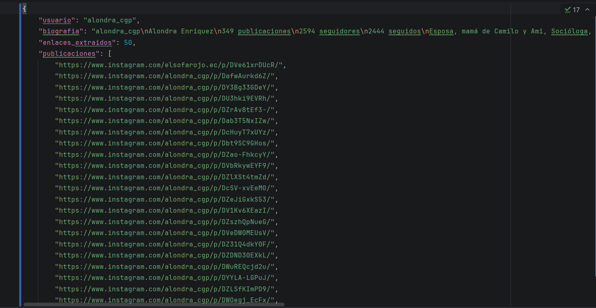

# Instagram Scraper con Playwright 

Este es un proyecto didáctico desarrollado en Python para extraer información pública de perfiles de Instagram de forma automatizada, evadiendo los bloqueos y sistemas antibot de Meta.

##  Características

*   **Evasión de Bloqueos:** Utiliza la inyección directa de cookies de sesión para saltarse el formulario de inicio de sesión y evitar baneos de IP.
*   **Navegación Dinámica:** Construido sobre **Playwright**, interactúa directamente con el Virtual DOM de React de Instagram, realizando scroll dinámico (*Lazy Loading*) para cargar elementos.
*   **Extracción Estructurada:** Obtiene métricas precisas del perfil (usuario, nombre real, seguidores, seguidos, publicaciones, biografía).
*   **Exportación a JSON:** Guarda automáticamente todos los datos recopilados y las URLs de las últimas 50 publicaciones en un archivo `datos_perfil.json` estructurado y limpio.

##  Tecnologías Utilizadas

*   **Python 3.x**
*   **Playwright** (Motor Chromium)

##  Instalación y Configuración

Sigue estos pasos para ejecutar el proyecto en cualquier computadora local:

**1. Clonar el repositorio**
```bash
git clone https://github.com/TU-USUARIO/TU-REPOSITORIO.git
cd TU-REPOSITORIO
```

**2. Instalar dependencias**
```bash
pip install -r requirements.txt
```

**3. Instalar los binarios del navegador (Obligatorio)**
Playwright necesita descargar su propio motor interno de Chromium:
```bash
playwright install chromium
```

**4. Configurar Credenciales (Muy Importante)**
Por motivos de seguridad, las credenciales están ignoradas en GitHub (`.gitignore`). Debes crear un archivo llamado `cookies.json` en la raíz del proyecto.

Usa las herramientas de desarrollador de tu navegador (F12 > Application > Cookies) en una cuenta *descartable* de Instagram y pega los 5 tokens esenciales con esta estructura:

```json
[
  { "name": "sessionid", "value": "TU_VALOR", "domain": ".instagram.com", "path": "/" },
  { "name": "csrftoken", "value": "TU_VALOR", "domain": ".instagram.com", "path": "/" },
  { "name": "ds_user_id", "value": "TU_VALOR", "domain": ".instagram.com", "path": "/" },
  { "name": "ig_did", "value": "TU_VALOR", "domain": ".instagram.com", "path": "/" },
  { "name": "mid", "value": "TU_VALOR", "domain": ".instagram.com", "path": "/" }
]
```
>  **Advertencia:** Nunca hagas commit de tu `cookies.json` público y no utilices tu cuenta personal de Instagram para hacer scraping.


##  Uso

Una vez configurado el archivo de cookies, ejecuta el script principal:

```bash
python scraper.py
```

El navegador se abrirá automáticamente, navegará al perfil objetivo, extraerá la información simulando el comportamiento humano, y finalmente generará el archivo `datos_perfil.json` con los resultados.




##  Propósito
Proyecto desarrollado con fines netamente académicos y didácticos para la comprensión de arquitecturas web modernas (SPA/React), automatización de navegadores mediante WebSockets y extracción de datos.